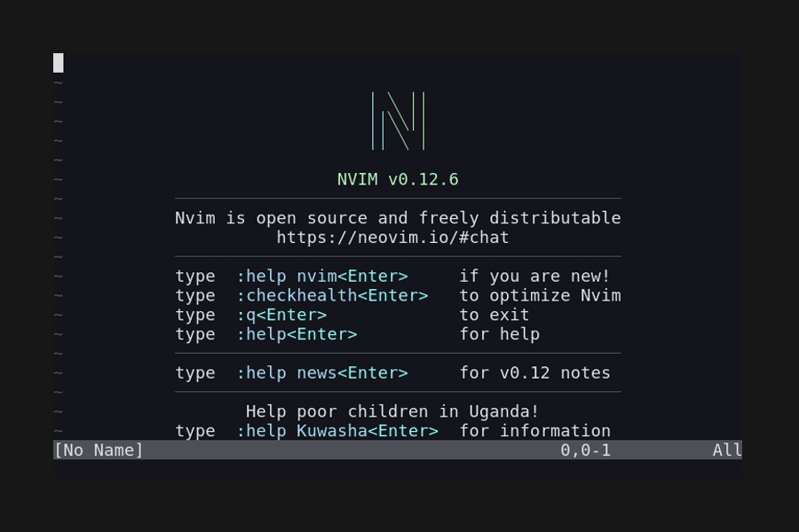

# eina.nvim

A pixel-art pet that lives in Neovim.



## The idea

You feed eina political books. Each book nudges it on a two-axis grid:

- **economic:** left ↔ right
- **social:** authority ↔ freedom

Where it ends up decides which of 5 forms it takes: authoritarian-left,
authoritarian-right, libertarian-left, libertarian-right, or moderate in the
center. Every direction is equally silly, so anyone can laugh at their own pet.

## Status

Early days. What works today:

- eina in a habitat window in the center of the screen
- an idle animation: it blinks, and glances left and right
- mood and satiety bars

Not yet: the actions (`[f]`, `[b]`, `[s]`, `[q]`) are shown but don't do
anything, the bars stay full, and there are no books or forms yet.

## Requirements

- Neovim 0.10 or newer
- A terminal with true color (24-bit) support

## Installation

With [lazy.nvim](https://github.com/folke/lazy.nvim):

```lua
{ "jimmynando/eina.nvim" }
```

## Usage

`:Eina` shows or hides eina.

eina doesn't set any keymaps on its own. To add one:

```lua
vim.keymap.set("n", "<leader>pp", "<cmd>Eina<CR>", { desc = "Toggle eina pet" })
```

## Customizing colors

The habitat borrows its colors from your colorscheme. To change one, set the
highlight group in your config:

| Group | Used for | Default |
|---|---|---|
| `EinaMood` | mood bar | `DiagnosticOk` (green) |
| `EinaSatiety` | satiety bar | `DiagnosticInfo` (blue) |
| `EinaLow` | any bar below 30% | `DiagnosticError` (red) |
| `EinaKey` | the keys in `[f] Feed` | `Special` |
| `EinaBarEmpty` | the empty part of a bar | `NonText` |
| `EinaFloor` | the floor line | `FloatBorder` |

For example:

```lua
vim.api.nvim_set_hl(0, "EinaMood", { fg = "#00ff00" })
```

## How eina is drawn

Sprites are plain text in `lua/eina/sprite.lua`, one character per pixel:
`.` is empty, and any other character is a color from the palette. Two pixels
share one terminal cell using half-blocks (`▀` `▄`), which keeps them square.
A `_` draws a line thinner than a pixel, used for the closed eyes. The
animation is a list of frames and how long each one shows, in the same file.

## Updating the demo GIF

`demo.gif` is recorded with [VHS](https://github.com/charmbracelet/vhs) from
`demo.tape`. After changing how eina looks, run this from the repo root:

```sh
vhs demo.tape
```
